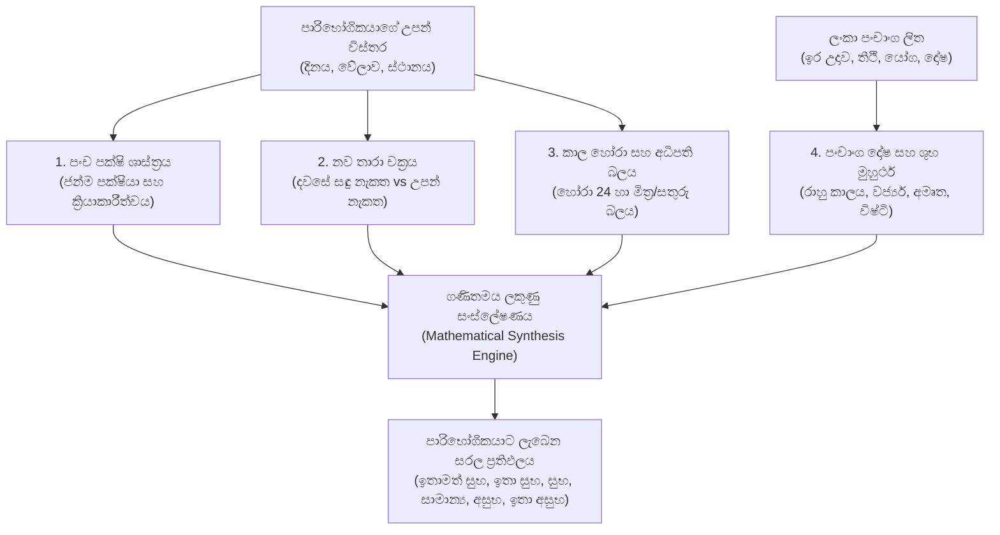

# Daily Fortune — පූර්ණ ජ්‍යෝතිෂ න්‍යාය සහ ගණනය කිරීමේ අත්පොත
### (Astrological Theory & Manual Calculation Guide)

> **පරමාර්ථය:**  
> කෙනෙකුගේ උපන් දිනය, වේලාව සහ ස්ථානය ලබා දුන් විට, **Daily Fortune** මෘදුකාංගය මගින් සෑම මිනිත්තුවක් පාසාම සුභ/අසුභ තත්වය ගණනය කර සරල කාලසටහනක් (6-Tier Schedule) ලබාදෙන ආකාරය, ලංකා පංචාංග ග්‍රහස්පුට ලිත සහ පුරාණ ජ්‍යෝතිෂ මූලධර්ම ඇසුරෙන් අතින් (Manually) ගණනය කරන අයුරු සම්පූර්ණයෙන්ම තේරුම් ගැනීම.

---

## 1. හැඳින්වීම: Daily Fortune ක්‍රමයේ මූලික රහස

සාමාන්‍ය පත්තරයක හෝ රූපවාහිනියේ කියවෙන "ලග්න පලාපල" ලෝකයේ සිටින මිලියන ගණනක් වන එකම ලග්නයේ සියලු දෙනාටම එක හා සමානව කියවෙන පොදු අනාවැකියකි. නමුත් **Daily Fortune** යනු එවැනි සාමාන්‍ය දෙයක් නොවේ.

මෙය පුද්ගලයෙකුගේ **ජීව-රිද්මය (Personal Astrological Bio-Rhythm)** පදනම් කරගත් පුද්ගලාරෝපිත කාල සටහනකි. පුරාණ ඉසිවර මතය අනුව මිනිසාගේ ශරීරයේ සහ මනසේ ශක්ති මට්ටම දවසේ විවිධ හෝරාවන් වලදී ඉහළ යාම සහ පහළ යාම සිදුවේ. අතීතයේ සිට මෙරට සිටි ප්‍රවීණ ජ්‍යෝතිෂවේදීන් තම සමීපතමයින්ට පමණක් සාදා දුන් මෙම රහස් ක්‍රමවේදය ගොඩනැගී ඇත්තේ ප්‍රධාන කුළුණු 4ක් මතය:

---

## 2. පියවර 1: උපන් වේලාවෙන් "ජන්ම සාධක" අතින් සොයාගන්නා හැටි

කෙනෙකු තමන්ගේ උපන් දිනය, උපන් වේලාව සහ උපන් ස්ථානය (නගරය) දුන් විට ජ්‍යෝතිෂවේදියෙකු ලිත ඇසුරෙන් පහත කරුණු 5 සොයා ගනී:

### (අ) අයනාංශය සහ චන්ද්‍ර ස්පුටය (Moon's Sidereal Longitude)
1. උපන් වේලාවේදී අහසේ සඳු (චන්ද්‍රයා) ගමන් කරමින් සිටි නිශ්චිත අංශක ප්‍රමාණය (ස්පුටය) ලිතේ දෛනික ග්‍රහස්පුට සටහනෙන් සොයා ගැනේ (ලහිරි / චිත්‍රපක්ෂ අයනාංශය යොදා ගනී).
2. මුළු අහස අංශක 360ක් වන අතර, එය නැකත් 27කට බෙදූ විට **එක් නැකතක ප්‍රමාණය අංශක 13 කලා 20ක් (13° 20')** වේ.
3. එක් නැකතක් පාද 4කට බෙදූ විට **එක් පාදයක ප්‍රමාණය අංශක 3 කලා 20ක් (3° 20')** වේ.
4. චන්ද්‍ර ස්පුටය අංශක 13° 20' න් බෙදූ විට ජන්ම නැකතත් (1 සිට 27 දක්වා), ශේෂයෙන් නැකත් පාදයත් (1 සිට 4 දක්වා) ලැබේ.

### (ආ) පුර පක්ෂයද අව පක්ෂයද යන්න තීරණය කිරීම (Shukla / Krishna Paksha)
- සූර්යයා සහ චන්ද්‍රයා අතර කෝණික පරතරය මනිනු ලැබේ:
  - සූර්යයාගේ සිට චන්ද්‍රයා ඉදිරියෙන් අංශක 0° සිට 180° දක්වා නම් = **පුර පක්ෂය (Shukla Paksha)**
  - සූර්යයාගේ සිට චන්ද්‍රයා අංශක 180° සිට 360° දක්වා නම් = **අව පක්ෂය (Krishna Paksha)**

### (ඇ) ජන්ම පක්ෂියා (Pancha Pakshi) සොයාගැනීම
පංච පක්ෂි ශාස්ත්‍රයේ පක්ෂීන් 5 දෙනෙකි:
1. **භේරුණ්ඩ / ගිජුලිහිණියා (Vulture)**
2. **බක / පිඟාන / බස්සා (Owl)**
3. **කපුටා (Crow)**
4. **කුකුළා (Cock)**
5. **මයුරා / මොනරා (Peacock)**

පුර පක්ෂයට සහ අව පක්ෂයට නැකත් 27 බෙදී යන සම්ප්‍රදායික වගුව:

| පක්ෂියා (Bird) | පුර පක්ෂයේ උපන් නැකත් (Shukla) | අව පක්ෂයේ උපන් නැකත් (Krishna) |
| :--- | :--- | :--- |
| **භේරුණ්ඩ (Vulture)** | 1. අස්විද සිට 5. මුවසිරස දක්වා | 22. සුවණ සිට 27. රේවතී දක්වා |
| **බක / බස්සා (Owl)** | 6. අද සිට 11. පුවපල් දක්වා | 17. අනුර සිට 21. උතුරුසල දක්වා |
| **කපුටා (Crow)** | 12. උත්රපල් සිට 16. විසා දක්වා | 12. උත්රපල් සිට 16. විසා දක්වා |
| **කුකුළා (Cock)** | 17. අනුර සිට 21. උතුරුසල දක්වා | 6. අද සිට 11. පුවපල් දක්වා |
| **මයුරා (Peacock)** | 22. සුවණ සිට 27. රේවතී දක්වා | 1. අස්විද සිට 5. මුවසිරස දක්වා |

> **උදාහරණයක්:** යමෙකු පුර පක්ෂයේ රෙහෙන (4 වන) නැකතින් ඉපදුනේ නම් ඔහුගේ ජන්ම පක්ෂියා **භේරුණ්ඩ** වේ.

### (ඈ) උපන් ලග්නය සහ නවාංශකය
- උපන් ස්ථානයේ අක්ෂාංශ/දේශාංශ සහ උපන් වේලාවේ සූර්ය උදාව පාදක කරගෙන නැගෙනහිර ක්ෂිතිජයෙන් උදාවූ රාශිය (ලග්නය) සහ නවාංශකය සොයා ගනී.
- ලග්නාධිපතියා කවුද යන්න (උදා: මේෂ නම් කුජ, වෘෂභ නම් සිකුරු) මෙහිදී සටහන් කර ගනී.

---

## 3. පියවර 2: දවසේ වේලාව කොටස් වලට බෙදීම (Daily Time Division)

ජ්‍යෝතිෂයේ දවස ගණනය කරන්නේ මධ්‍යම රාත්‍රී 12:00 න් නොව **ඉර උදාවූ මොහොතේ (Sunrise)** සිට ඊළඟ දවසේ ඉර උදාව දක්වාය.

1. **දහවල් කාලය (Daytime):** සූර්යෝදයේ සිට සූර්යාස්තය (Sunset) දක්වා කාලය.
2. **රාත්‍රී කාලය (Nighttime):** සූර්යාස්තයේ සිට පසුදා සූර්යෝදය දක්වා කාලය.

### පංච පක්ෂි යාම 5 (Five Yamas)
දහවල් කාලය හරියටම **සමාන කොටස් 5 කට (යාම 5)** බෙදනු ලැබේ. රාත්‍රී කාලයද ඒ අයුරින්ම **සමාන යාම 5 කට** බෙදනු ලැබේ.
- දහවල් කාලය සාමාන්‍යයෙන් පැය 12ක් නම්:
  $$\text{එක් යාමයක දිග} = \frac{12 \text{ පැය}}{5} = \text{පැය 2 විනාඩි 24යි (විනාඩි 144යි)}$$
- Daily Fortune ඇප් එක මගින් සූර්යයාගේ නියම උදාව සහ බැසීම තත්පරයටම ගණනය කර මෙම යාම 5 තීරණය කරයි.

---

## 4. පියවර 3: පංච පක්ෂි අවස්ථා 5 සහ අතුරු අවස්ථා (Main & Sub Activities)

පක්ෂියෙකුට එක් දිනකදී හිමිවන අවස්ථා (ක්‍රියාකාරකම්) 5කි. මිනිසාගේ ජීව ශක්තිය සහ මානසික ඒකාග්‍රතාවය මේ අනුව වෙනස් වේ:

| අවස්ථාව (Activity) | අර්ථය හා ගුණාංග | ජ්‍යෝතිෂ ලකුණු මට්ටම |
| :--- | :--- | :---: |
| **1. රජ (Rule)** | පූර්ණ බලය, ජයග්‍රහණය, රාජ්‍ය ගෞරවය, සියලු කාර්යයන් සාර්ථක වීම | **+17 (ඉතා ඉහළ)** |
| **2. භෝජන (Eat)** | සතුට, ධන ලාභ, ප්‍රබෝධය, ආහාර පාන සහ සුභ ආරංචි ලැබීම | **+12 (ඉහළ)** |
| **3. ගමන (Walk)** | චලනය, සාමාන්‍ය ගමන් බිමන්, මධ්‍යස්ථ ප්‍රතිඵල | **+3 (මධ්‍යස්ථ)** |
| **4. නිදි (Sleep)** | අලස බව, උදාසීන බව, ප්‍රමාදය, වැදගත් තීරණ අසාර්ථක වීම | **-10 (අඩු)** |
| **5. මරණ (Die)** | පූර්ණ අක්‍රියතාවය, පාඩු, බාධක, ආරවුල්, අනතුරුදායක බව | **-19 (ඉතා අඩු)** |

### සතියේ දිනය අනුව පළමු යාමය තීරණය වීම:
සතියේ දිනය (ඉරිදා, සඳුදා ආදී) සහ පක්ෂය (පුර/අව) අනුව එක් එක් යාමයේ රජ වන, කන, ඇවිදින, නිදන, මැරෙන පක්ෂීන් කවුරුන්දැයි ලිතේ වගුගත කර ඇත.
- උදාහරණයක් ලෙස: පුර පක්ෂයේ ඉරිදා දින පළමු යාමයේ භෝජන (කෑම) ලබන්නේ **භේරුණ්ඩ** පක්ෂියාය. ඉන්පසු චක්‍රය අනුව අනික් පක්ෂීන් පිළිවෙළින් ක්‍රියාත්මක වේ.

### යාමයක් තුළ අතුරු අවස්ථා 5කට බෙදීම (Sub-Periods):
එක් යාමයක් විනාඩි 144ක් නම්, එම විනාඩි 144 ඇතුළතද නැවත පක්ෂීන් 5 දෙනාගේ අතුරු ක්‍රියා 5ක් සිදුවේ.
- අතුරු අවස්ථාවන් වල කාල ප්‍රමාණය එක සමාන නොවේ:
  - **රජ අතුරු කාලය:** විනාඩි 48
  - **ගමන අතුරු කාලය:** විනාඩි 36
  - **භෝජන අතුරු කාලය:** විනාඩි 30
  - **නිදි අතුරු කාලය:** විනාඩි 18
  - **මරණ අතුරු කාලය:** විනාඩි 12
  *(මුළු එකතුව = විනාඩි 144)*

> **Daily Fortune රහස:** ප්‍රධාන යාමයෙන් රජ හෝ භෝජන ලබා සිටියදී, අතුරු කාලයෙනුත් රජ හෝ භෝජන ලැබෙන මිනිත්තු කිහිපය පුද්ගලයෙකුට ලොතරැයියක් ඇදෙනවාක් මෙන් **අතිශය වාසනාවන්ත (Supreme)** අවස්ථාවකි!

---

## 5. පියවර 4: නව තාරා චක්‍රය (Daily Transit Nava Tara Chakra)

දවසේ ඕනෑම මොහොතක අහසේ චන්ද්‍රයා ගමන් කරන නැකත, කෙනෙකුගේ උපන් නැකත සමඟ සසඳන ක්‍රමය **නව තාරා චක්‍රය** නම් වේ.

### ගණනය කරන සූත්‍රය:
$$\text{තාරා අංකය} = \left[(\text{දවසේ සඳු සිටින නැකත} - \text{ජන්ම නැකත}) \pmod{27} \pmod{9}\right] + 1$$

| අංකය | තාරාවේ නම (Tara) | ඵලය හා තත්වය | ලකුණු (Points) |
| :---: | :--- | :--- | :---: |
| **1** | **ජන්ම (Janma)** | ශරීර වෙහෙස, සාමාන්‍ය බාධක | -3 |
| **2** | **සම්පත් (Sampath)** | ධනය, ලාභය, ව්‍යාපාර දියුණුව, වාසනාව | **+14** |
| **3** | **විපත් (Vipat)** | අනතුරු, පාඩු, බලාපොරොත්තු කඩවීම | **-15** |
| **4** | **ක්ෂේම (Kshema)** | ආරක්ෂාව, සතුට, නිරෝගීභාවය | **+11** |
| **5** | **ප්‍රත්‍යාරි (Pratyak)** | සතුරන් ඇතිවීම, විරෝධතා, නඩුහබ | **-13** |
| **6** | **සාධක (Sadhaka)** | අරමුණු ඉටුවීම, ජයග්‍රහණය, විභාග ජය | **+13** |
| **7** | **වධ / නෛධන (Vadha)** | අතිශය අසුභයි, විපත්ති, මාරක බාධක | **-22** |
| **8** | **මිත්‍ර (Mitra)** | සහයෝගය, මිතුරන්ගෙන් උදව්, ප්‍රීතිය | **+12** |
| **9** | **පරම මිත්‍ර (Parama Mitra)** | උසස්ම සුභ ඵල, ප්‍රධාන ගනුදෙනු වලට සුදුසුයි | **+16** |

> **විශේෂ සටහන:** කෙනෙකුට 7 වන තාරාව හෙවත් **"වධ තාරාව"** ලබන කාලය තුළ වෙනත් කුමන සුභ යෝග තිබුණද එම කාලය "ඉතාමත් සුභ" (Supreme) මට්ටමට පත් නොවේ. මන්ද එය අතිශය අවදානම් කාලයකි.

---

## 6. පියවර 5: කාල හෝරා (24 Kala Horas) සහ චන්ද්‍රබලය

### (අ) දවසේ හෝරා 24 (Chaldean Order)
දවසේ සෑම පැයකටම අධිපති ග්‍රහයෙකු සිටී. සූර්යෝදයේදී පටන් ගන්නා පළමු හෝරාවේ අධිපතියා වන්නේ එදින දිනයට අධිපති ග්‍රහයාය (උදා: ඉරිදා නම් රවි හෝරාව, සඳුදා නම් සඳු හෝරාව). ඉන්පසු හෝරා 24 ක්‍රියාත්මක වන්නේ අහසේ කක්ෂ වේගය අනුවය:
$$\text{සෙනසුරු} \rightarrow \text{ගුරු} \rightarrow \text{කුජ} \rightarrow \text{රවි} \rightarrow \text{සිකුරු} \rightarrow \text{බුධ} \rightarrow \text{සඳු}$$

- උපන් කේන්ද්‍රයේ ලග්නාධිපතියාට සහ නැකත් අධිපතියාට **මිත්‍ර ග්‍රහයෙකුගේ හෝරාවක්** පැවතුණහොත් සුභ ලකුණු වැඩිවේ.
- **සතුරු ග්‍රහයෙකුගේ හෝරාවක්** පැවතුණහොත් සුභ ලකුණු අඩුවේ.

### (ආ) චන්ද්‍රබලය සහ චන්ද්‍රාෂ්ටමය (Chandrashtama)
- දවසේ සඳු ගමන් කරන රාශිය, තමන් උපන් රාශියේ සිට 1, 3, 6, 7, 10, 11 යන ස්ථාන වල ගමන් කරන්නේ නම් චන්ද්‍රබලය ලැබේ (+8 සිට +10 දක්වා).
- නමුත් තමන් උපන් රාශියෙන් **8 වන රාශියේ සඳු ගමන් කරන කාලය (චන්ද්‍රාෂ්ටමය)** නම් දැඩි චිත්ත පීඩා ගෙන දෙන බැවින් ලකුණු -22 කින් අඩු කෙරේ.

---

## 7. පියවර 6: ලංකා පංචාංග ලිතේ විශේෂ දෝෂ සහ ශුභ මුහුර්ථ

දක්ෂ ජ්‍යෝතිෂවේදියෙකු කිසිවිටෙකත් ඉහත කරුණු පමණක් නොබලයි. ලංකා පංචාංග ලිතේ සඳහන් වන බලවත් දෝෂ මග හැරිය යුතුය:

1. **රාහු කාලය (Rahu Kaalam):**
   - දහවල් කාලය කොටස් 8කට බෙදූ විට සතියේ දවස අනුව යෙදෙන 1/8 ක කාලය (පැය 1 1/2ක් පමණ).
   - *ලකුණු -28කින් පහත බසින අතර උපරිම ලකුණු සීමාව (Hard Cap) 38කට තදින්ම සීමා කෙරේ. කිසිවිටෙකත් සුභ හෝ ඉතා සුභ විය නොහැක!*
2. **නැකත් වර්ජ්‍ය කාලය (Varjyam / Visha Ghatis):**
   - සෑම නැකතකටම අදාළව ලිතේ දක්වා ඇති විෂ ඝටී 4ක (පැය 1 විනාඩි 36ක) කාලය. මෙම කාලය තුළ කරන වැඩ විනාශ වේ.
3. **විෂ්ටි කරණය (Vishti Karana / Bhadra):**
   - ලිතේ කරණ 11 න් විෂ්ටි කරණය ලබන වේලාව.
4. **යමගණ්ඩය සහ ගුලික කාලය (Yamaganda & Gulika):**
   - අසුභ ප්‍රතිඵල දෙන කාල පරාස.
5. **මරණ යෝග / දග්ධ තිථි (Marana Yoga & Dagdha Tithi):**
   - දිනය සහ නැකත ගැටීමෙන් ඇතිවන මරණ යෝගය.
6. **අමෘත ඝටී / අභිජිත් මුහුර්ථය (Amrita Kalam & Abhijit Muhurtha):**
   - දවසේ මැද භාගයේ (දහවල් 11:36 - 12:24 අතර) යෙදෙන අභිජිත් මුහුර්ථය සහ ලිතේ එන අමෘත කාලය මගින් අතිරේක +14 සිට +18 දක්වා සුභ ලකුණු ලැබේ.

---

## 8. පියවර 7: අවසාන 6-Tier ශ්‍රේණිය (The 6-Grade Synthesis)

Daily Fortune ඇල්ගොරිතමය ඉහත සියලුම සාධක ගණිතමය ලකුණු ක්‍රමයකට (Scoring Matrix) ගෙන එයි:

$$\text{මුළු ලකුණු වෙනස } (\Delta) = \text{පක්ෂි ලකුණු} + \text{තාරා බලය} + \text{චන්ද්‍ර බලය} + \text{හෝරා බලය} + \text{ලග්න බලය} + \text{ලිතේ යෝග/දෝෂ}$$

$$\text{අවසාන ලකුණ (Score)} = 50 + (\Delta \times 0.72) \quad [\text{දෝෂ පවතී නම් Hard-Cap අගයන් යෙදේ}]$$

මෙම ලකුණ (0 සිට 100 දක්වා) පාරිභෝගිකයාට ක්ෂණිකව තේරුම් ගත හැකි **පැහැදිලි ශ්‍රේණි 6කට** වෙන් කෙරේ:

| ලකුණු පරාසය | මෘදුකාංගයේ කේතය | පාරිභෝගිකයාට පෙනෙන තත්වය | වර්ණය | තේරුම සහ කළ යුතු දේ |
| :---: | :---: | :---: | :---: | :--- |
| **86 – 100** | `SUPREME` | **ඉතාමත් සුභ** | 🟣 රන්වන් / දම් | ඉහළම වාසනාවන්ත වේලාව. මංගල කටයුතු, ගිවිසුම් අත්සන් කිරීම, රැකියා සම්මුඛ පරීක්ෂණ, ආයෝජන වලට අතිශය සුදුසුයි. කිසිදු දෝෂයක් නොමැත. |
| **73 – 85** | `VERY_GOOD` | **ඉතා සුභ** | 🟢 තද කොළ | ඉතා යහපත් ප්‍රතිඵල දෙන කාලයකි. නව වැඩ ඇරඹීමට, මුදල් ගනුදෙනු වලට, සාකච්ඡා වලට සුදුසුයි. |
| **58 – 72** | `GOOD` | **සුභ** | 🌿 ලා කොළ | සාර්ථක ප්‍රතිඵල ලැබේ. එදිනෙදා වැදගත් රාජකාරි කර ගැනීමට සුදුසුයි. |
| **42 – 57** | `NEUTRAL` | **සාමාන්‍ය** | ⚪ අළු / සුදු | සුභ හෝ අසුභ ප්‍රබල නැත. සාමාන්‍ය දවසේ වැඩ කරගෙන යාමට බාධාවක් නැත. |
| **25 – 41** | `BAD` | **අසුභ** | 🟠 තැඹිලි | බාධක, ප්‍රමාදයන් ඇතිවේ. වැදගත් තීරණ ගැනීමෙන් වළකින්න. |
| **0 – 24** | `VERY_BAD` | **ඉතා අසුභ** | 🔴 තද රතු | රාහු කාලය, මරණ අවස්ථාව හෝ වධ තාරාව ක්‍රියාත්මක වේ. රණ්ඩු සරුවල්, මුදල් හානි, අනතුරු විය හැක. කිසිදු සුභ වැඩක් නොකරන්න. |

### කාල පරාස සැකසීම (Intelligent Row Merging):
මෘදුකාංගය මගින් සෑම විනාඩියක්ම පරීක්ෂා කළද, පාරිභෝගිකයාට විනාඩි 2න් 2ට ලැයිස්තු නොපෙන්වයි. සමාන තත්වයන් එකට එකතු කර (Merge & Smooth), අතීතයේ මිතුරා ලියා දුන්නාක් මෙන්:
> `උදේ 08:10 සිට 11:43 දක්වා - සුභයි`  
> `11:43 සිට 12:20 දක්වා - ඉතා සුභයි`  
> `12:20 සිට 03:10 දක්වා - ඉතා අසුභයි`  
ලෙස පිරිසිදු, පැහැදිලි කාලසටහනක් ලෙස මේසය මත තබයි.

---

## 9. පාරිභෝගිකයින්ට සහ ගැණුම්කරුවන්ට මෙය විකුණන විට පැහැදිලි කරන ආකාරය (Sales & FAQ Guide)

ඔබ මෙම මෘදුකාංගය පාරිභෝගිකයින්ට, ව්‍යාපාරිකයින්ට හෝ ජ්‍යෝතිෂවේදීන්ට විකිණීමේදී ඔවුන් නගන ප්‍රශ්න වලට දිය යුතු වෘත්තීය පිළිතුරු මෙන්න:

### ප්‍රශ්නය 1: "මොකක්ද මේ ඇප් එකේ තියෙන වෙනස? පත්තර වලත් රාශි පලාපල තියෙන්නේ?"
> **ඔබේ පිළිතුර:**  
> *"පත්තරේ තියෙන්නේ ලෝකයේ ඉන්න කෝටි ගණනක් මේෂ ලග්න හිමියන්ටම පොදු අනාවැකියක්. ඒකෙන් ඔබට අද දවසේ ගිවිසුමක් අත්සන් කරන්න, ඉන්ටවීව් එකකට යන්න, ලක්ෂ ගණනක බිස්නස් එකක් කතා කරන්න හොඳම වෙලාව හොයාගන්න බැහැ.  
> නමුත් **Daily Fortune** කියන්නේ ඔබේම උපන් වේලාවට, ඔබේම උපන් නැකතට සහ ඔබේම ජන්ම පක්ෂියාට අනුව හැදෙන **පුද්ගලික ජෛව-කාලසටහනක් (Personal Bio-Rhythm Schedule)**. ලංකා පංචාංග ලිතේ තියෙන රාහු කාලය, හෝරාව, තාරා බලය සේරම එකතු කරලා ඔබටම විතරක් ඔබේ දවස කළමනාකරණය කරගන්න දෙන විද්‍යාත්මක උපදේශකයෙක්."*

### ප්‍රශ්නය 2: "මම කේන්දර ගැන දන්නේ නැහැ, මට මේකෙන් තේරෙයිද?"
> **ඔබේ පිළිතුර:**  
> *"අනිවාර්යයෙන්ම! සාමාන්‍ය කෙනෙකුට කපුටු, කුකුළු, වධ තාරා, විෂ්ටි කරණ කියලා ජ්‍යෝතිෂ වචන කිව්වම තේරෙන්නේ නැහැ. ඔළුව අවුල් වෙනවා.  
> ඒ නිසයි අපි මේක හදලා තියෙන්නේ පොඩි ළමයෙකුට වුණත් බැලූ බැල්මට තේරෙන සරල වර්ණ 6 කින් (කොළ පාට නම් හොඳයි, රතු පාට නම් වැඩේ නවත්තන්න). ඔබට තියෙන්නේ ඔබේ දවස පටන් ගන්න කලින් ෆෝන් එකෙන් අද දවසේ 'ඉතාමත් සුභ' වෙලාව සහ 'අසුභ' වෙලාව බලාගෙන ඒ අනුව දවසේ වැඩ ටික ප්ලෑන් කරගන්න විතරයි."*

### ප්‍රශ්නය 3: "ජ්‍යෝතිෂවේදියෙක් ඇහුවොත්: මේක ලංකාවේ ක්‍රමයට ගැලපෙනවද?"
> **ඔබේ පිළිතුර:**  
> *"100%ක්ම ගැලපෙනවා. මේ මෘදුකාංගය පිටුපස ක්‍රියාත්මක වන්නේ ලංකා පංචාංග ග්‍රහස්පුට ලිතේ නිවැරදි සූර්ය උදාව, චිත්‍රපක්ෂ (ලහිරි) අයනාංශය, පුරාණ පංච පක්ෂි ශාස්ත්‍රය, නව තාරා චක්‍රය, කාල හෝරා සහ රාහු කාලයයි. ප්‍රවීණ ජ්‍යෝතිෂවේදියෙකුට පැය 3ක් තිස්සේ ලිත පෙරළලා අමාරුවෙන් හදන්න වෙන චාර්ට් එක මේ ඇප් එක තත්පර 1 කින් සකසා දෙනවා."*

---

## 10. සාරාංශය (Summary)

**Daily Fortune** යනු අනුමාන අනාවැකි කියන ඇප් එකක් නොවේ. එය:
1. **නිරවද්‍ය තාරකා විද්‍යාව (High-Precision Astronomy)**
2. **පුරාණ පංචාංග ගණිතය (Classical Panchanga Mathematics)**
3. **පංච පක්ෂි ජීව-ශක්ති විද්‍යාව (Bio-Rhythmic Energy Timing)**
එක්තැන් කොට, නවීන ලෝකයේ මිනිසුන්ට තමන්ගේ දවසේ ජයග්‍රහණය උදාකර ගැනීමට සාදාදුන් අසමසම ප්‍රායෝගික මෙවලමකි!
